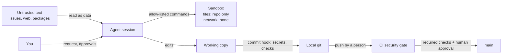

# Threat model: a coding agent working on OrderHub (Lecture 7.1)

A coding agent is a privileged actor: it reads the repository, runs commands with your user's rights, and can reach the network unless something stops it. Model it the way you'd model a new contractor with your laptop.

## Assets

| Asset | Where it lives | What harm looks like |
|---|---|---|
| Source and history | the repository, the remote | wrong code merged; history rewritten; force-push |
| Credentials | `.env`, shell environment, `~/.ssh`, `~/.aws`, CI secrets, the warehouse token | a key copied into code, a commit, a log, a prompt, or sent to another host |
| Customer data | databases, handoff files, logs | personal data in logs (R10), in test fixtures, or sent to a third party |
| The billing handoff | `orders.py` → CSV → legacy batch | finance bills from wrong or partial data (R7) |
| The pipeline | `.github/workflows/`, hooks, `.claude/settings.json` | checks weakened; the agent loosens its own permissions |
| Dependencies | `requirements.lock` | an unneeded, duplicate, invented or malicious package installed |

## Actors and the text they control

| Actor | Trusted? | Reaches the agent through |
|---|---|---|
| You (the person running the session) | yes | the request |
| Your team | yes, with review | code, AGENTS.md, specs, commit messages |
| Customers, vendors, the public | **no** | issues, support tickets (Q15), emails, vendored READMEs, web pages, package metadata |
| MCP servers and plugins | only as far as vetted | tool descriptions and tool results |
| The model itself | no (it can be wrong or steered) | every action it proposes |

## Trust boundaries

## Controls, by layer (each assumes the one before it can fail)

1. **Context:** AGENTS.md says untrusted text is data, and never to put credentials in code (Lecture 7.5).
2. **Permissions:** allow-list the project's commands; deny push, network tools, installs, `.env` reads, edits to `instructor/` and `.claude/` (Lecture 7.2; `make security` checks the profile).
3. **Sandbox:** OS-level limits on files and network for shell commands, where the platform supports it.
4. **Commit time:** the pre-commit hook runs the secret scanner and the checks the change needs (7.3).
5. **CI:** the security gate as a required check: secrets, permissions profile, static analysis, dependency audit, canary (7.8).
6. **Review:** a person reads risk first (Section 6) and approves.

## Questions for your own threat model

- What can the agent run without asking? What can it reach on the network?
- Which credentials are readable from the directory it starts in, or from its environment?
- Which text in its context did someone outside the team write?
- Could the agent change its own permissions, hooks or CI checks? Who would notice?
- What's the worst single command it could run, and what stops it?
